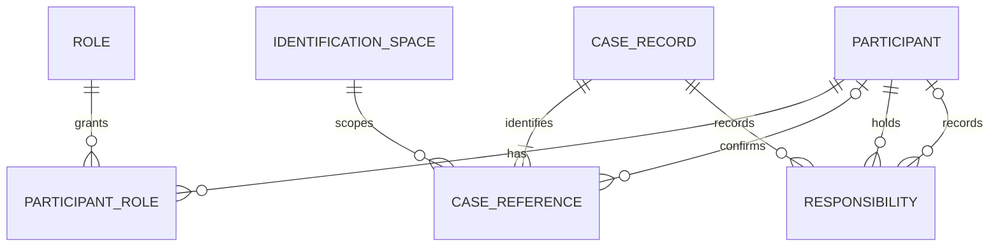

# TRASU data foundation v1

**BE-001 / G1 · technically ratified by I1 · operational after cross-review, CI and integration.** This contract defines the shared baseline and the exact scope of the first migration. The examples, codes and SQL are specifications, not evidence that production tables or authorization flows already exist.

## Decisions

| ID | Binding decision |
|---|---|
| DEC-DATA-001 | Stable internal UUID v4 for principal resources. |
| DEC-DATA-002 | At most one current holder per case and singular scope: `analyst`, `vocal`. Both applicable holders and a valid classification are required before ordinary analysis. |
| DEC-DATA-003 | `CurrentActor.id` identifies the server-authenticated participant, not the account or session. |
| DEC-DATA-004 | Business mutation and its success evidence commit in the same local transaction. |
| DEC-DATA-005 | Internal identity, institutional identification space, original reference and data provenance are distinct. |
| DEC-DATA-006 | Preserve history; no destructive referential cascades. |
| DEC-DATA-007 | Normalize domain data; JSONB only for justified structured evidence. |
| DEC-DATA-008 | Incremental migrations by owner and dependency; I1 owns sequence and schema approval. |
| DEC-DATA-009 | PostgreSQL 17, TypeORM `1.1.3`, `@nestjs/typeorm` `11.0.3`, Node `>=24.11.0 <25`; `synchronize=false`, `migrationsRun=false`. |
| DEC-DATA-010 | Persist unresolved incorporations independently; never create a placeholder case. |

**MVP identity convention:** only an explicitly governed institutional space and a confirmed reference can identify a case. The business key is `(space_code, match_key)`; remove only leading/trailing ASCII spaces, then compare under `COLLATE "C"`. Preserve input bytes as PostgreSQL UTF-8 text: no case folding, Unicode normalization, leading-zero removal or separator changes. Reject control characters from confirmed references. An original exceeding 256 UTF-8 bytes is **not confirmable in this MVP**; retain it intact in authorized intake for treatment, never truncate it. The cap is not an institutional rule. Same key with concordant evidence means repeat; same key with contradictory evidence means collision; unknown space/equivalence means unresolved, not a match. A source that communicates a reference does not gain authority to assign it. I1 provisions actual spaces after verifying authority; no institutional space is seeded by inference.

## Conceptual boundaries and core ER

Identity resolves an authenticated participant and current roles; authorization also checks action, resource and factual responsibility. A case contains confirmed institutional references, received document references and incidences. Responsibilities form history; reassignment requests and decisions are separate. Internal projects and exact versions belong to the documentary module; reviews, observations and corrective versions must preserve version provenance. Monitoring derives pending work and temporal results from authorized facts and applicable rules; missing evidence yields No Validado. Exchange relates to an exact action/version and distinct attempts/confirmation; derivation is not a legal outcome. Maintenance and audit may be global. No automatic legal effects, generic permissions engine or event sourcing.



The service creates a case and its first primary reference atomically; SQL enforces at most one primary and valid ownership, not existence. History permits multiple responsibilities per scope; the partial index guards only the current subset. Auth accounts/sessions, intake, reassignment and audit are separate later relations, not hidden columns or collections in the seven tables.

## AJ-01 · Minimum case contract

Observed sources: `frontend/src/data/expedients.ts:3–23`; `frontend/src/views/PendingView.tsx:56–117`, `LocateView.tsx:44–83`, `ExpedientDetail.tsx:113–260,419` and `TrackingPanel.tsx:120–146,230–242`. The mock's `type` values classify **work cards**, not institutional procedures.

| UI field | Source and storage rule |
|---|---|
| `reference` | Related original from primary `case_reference`; use stable case UUID in resource links. Search may be authorized and user-friendly, but search results never confirm identity. |
| `type`, `action` | Derived work projection: documentary pending task, monitoring activity or observation; “pending initial assignment” can derive from missing holders. Do not store UI labels as `classification_code` or a case status. Unavailable upstream data stays unavailable. |
| `responsibility`, `responsible`, `assignments` | Related current and historical responsibilities and participant display names; use holder UUID for filters, not display name. `unassigned` is a filter condition, not a participant. |
| `updated` | Derive from newest **authorized and relevant** known activity (case incorporation or assignment transition initially), return timestamp with semantics and format in UI. Not an editable date string; no fabricated date. |
| `status` | Derived conditions, not a copy of badge states. Baseline communicates classification missing and applicable holder gaps. Review and observation status belong to documentary; do not call an unavailable review “pending”. |
| `context` | Direct optional operational summary supplied by an authorized actor, without unsupported facts. New `operational_summary` is nullable text (1–1000 characters when present), not a legal conclusion or an embedded history. `case_id → operational_summary`. |
| `versions`, `evidence`, document counts, requests and exchanges | Summaries from owning modules with authorized lookup. Institutional documents and incidences are distinct BE-007b relations; keep references and provenance, no copied file or fake empty data to suggest a module ran. |
| Badge text/color, `forceEmpty`, `restricted`, loading, sort controls | Presentation/test state only; no persistence and no granted authority. |

**Walking Skeleton / BE-007b:** authorized lookup/list by reference and detail by case UUID, with primary original reference/space, `classificationCode` or null, `operationalSummary` or null, `incorporatedAt`, current holders by scope (`participantId`, label, effective start; missing scope is absent), assignment history on detail and only known, permitted derived data. Page results deterministically (UUID as tie-breaker); authorization filters precede pagination and counts. Resource outside the authorized scope does not reveal existence through an alternate reference or duplicate lookup. No final URL, DTO naming convention or page format changes existing OpenAPI. BE-010 integrates the login/authorized query path once its prerequisites pass; no simulation of unavailable modules.

## AJ-03 · Shared code registry

| Dimension | Codes and validation |
|---|---|
| Roles (`role`, persistent and governed) | `analyst`, `supervisor`, `reviewer`, `vocal`, `exchange`, `support`, `auditor`: map to the same demo actor identifiers in `frontend/src/types/navigation.ts:1` for display/translation only. They are internal labels; assignment and permissions must be verified server-side. No institutional role names, no implicit permissions, and no seed of live credentials. |
| Responsibility (controlled enum/check) | `analyst`, `vocal`. `reviewer` is a documentary step or assignment, not a global responsibility. |
| Case classification (controlled contract, currently no confirmed institutional taxonomy) | `null` = not identified or not validated, never sufficient for ordinary analysis. `ordinary` = ordinary circuit **only when established by validated input**, not a category of appeal or complaint. `special_route` = routing outside the ordinary circuit when supported; no internal handling authority. These are MVP operational routing codes, not normative classifications. Do not infer them from `Seguimiento`, `Revisión documental`, `Observaciones` or a document status. If the facts needed for classification are unavailable, persist reference and incidence but do not enable analysis. |
| Action and resource descriptors (module-owned controlled constants) | Minimum actions: `case:read`, `case:incorporate`, `case:assign`, `reassignment:request`, `reassignment:decide`, `audit:read`. Resources: `case`, `intake`, `responsibility`, `reassignment_request`, `audit_event`, `operations`. Use resource `case` with UUID for case reads and assignments; authorized incorporation uses `intake` (ID optional before creation). Reassignment decision uses exact request ID; audit uses exact event or a server-resolved allowed scope. These declare vocabulary, **not grants**. Others require owner/I1 agreement; unknown action/resource/scope denies. |
| Data and technical provenance | Minimum controlled provenance kinds `manual_entry`, `institutional_feed`, `test_fixture`; `institutional_feed` is recognized only for configured and verified sources, none provisioned here. `test_fixture` is nonproduction only. Server-emitter codes `case_service`, `audit_service`, `server_ingress`, `operations_service` identify technical emitters, not institutional authorities or authenticated actors. Codes must come from server configuration; clients cannot grant their own provenance. |

## Logical keys and exact BE-006 physical contract

PKs determine other attributes; alternate keys are `case_reference(space_code,match_key)` and the two subsets indexed for primary reference and current responsibility. `match_key` is a physical generated projection of the original, not an independent logical fact. The only composite PK, `(participant_id,role_code)`, determines `granted_at` as an association; names and role labels are not duplicated. The base relations are in 3NF under those dependencies; the stored derived key is a deliberate physical exception. Case fields depend on case identity, not reference text or assigned participant. Historical holders are successive facts, not copies of a case’s current state.

This PostgreSQL 17 DDL is the physical specification for **exactly seven tables**; do not apply it to a working database in this ticket. All non-null defaults, check constraints and indexes are explicit. Core relation FKs reject deletions and PK updates; the application protects business history from ad hoc edits.

```sql
CREATE TABLE participant (
  id uuid PRIMARY KEY DEFAULT gen_random_uuid(),
  display_name text NOT NULL CHECK (btrim(display_name) <> '')
);
CREATE TABLE role (
  code text COLLATE "C" PRIMARY KEY CHECK (code IN ('analyst','supervisor','reviewer','vocal','exchange','support','auditor')),
  label text NOT NULL CHECK (btrim(label) <> '')
);
CREATE TABLE participant_role (
  participant_id uuid NOT NULL REFERENCES participant(id) ON UPDATE RESTRICT ON DELETE RESTRICT,
  role_code text COLLATE "C" NOT NULL REFERENCES role(code) ON UPDATE RESTRICT ON DELETE RESTRICT,
  granted_at timestamptz NOT NULL DEFAULT CURRENT_TIMESTAMP,
  PRIMARY KEY (participant_id,role_code)
);
CREATE INDEX ix_participant_role_code ON participant_role(role_code,participant_id);
CREATE TABLE identification_space (
  code text COLLATE "C" PRIMARY KEY CHECK (octet_length(code) BETWEEN 1 AND 80 AND btrim(code) <> ''),
  label text NOT NULL CHECK (btrim(label) <> '')
);
CREATE TABLE case_record (
  id uuid PRIMARY KEY DEFAULT gen_random_uuid(),
  classification_code text CHECK (classification_code IN ('ordinary','special_route')),
  operational_summary text CHECK (btrim(operational_summary) <> '' AND char_length(operational_summary) <= 1000),
  incorporated_at timestamptz NOT NULL DEFAULT CURRENT_TIMESTAMP
);
CREATE TABLE case_reference (
  id uuid PRIMARY KEY DEFAULT gen_random_uuid(),
  case_id uuid NOT NULL REFERENCES case_record(id) ON UPDATE RESTRICT ON DELETE RESTRICT,
  space_code text COLLATE "C" NOT NULL REFERENCES identification_space(code) ON UPDATE RESTRICT ON DELETE RESTRICT,
  original_reference text NOT NULL CHECK (octet_length(original_reference) BETWEEN 1 AND 256 AND original_reference !~ '[[:cntrl:]]'),
  match_key text COLLATE "C" GENERATED ALWAYS AS (btrim(original_reference,' ')) STORED NOT NULL CHECK (match_key <> ''),
  is_primary boolean NOT NULL,
  confirmed_by_id uuid REFERENCES participant(id) ON UPDATE RESTRICT ON DELETE RESTRICT,
  source_kind text NOT NULL CHECK (source_kind IN ('manual_entry','institutional_feed','test_fixture')),
  source_key text NOT NULL CHECK (btrim(source_key) <> ''),
  confirmed_at timestamptz NOT NULL DEFAULT CURRENT_TIMESTAMP,
  CONSTRAINT uq_case_reference_identity UNIQUE (space_code,match_key)
);
CREATE UNIQUE INDEX uq_case_reference_primary ON case_reference(case_id) WHERE is_primary;
CREATE INDEX ix_case_reference_case ON case_reference(case_id);
CREATE TABLE responsibility (
  id uuid PRIMARY KEY DEFAULT gen_random_uuid(),
  case_id uuid NOT NULL REFERENCES case_record(id) ON UPDATE RESTRICT ON DELETE RESTRICT,
  scope text NOT NULL CHECK (scope IN ('analyst','vocal')),
  holder_id uuid NOT NULL REFERENCES participant(id) ON UPDATE RESTRICT ON DELETE RESTRICT,
  started_at timestamptz NOT NULL,
  ended_at timestamptz CHECK (ended_at IS NULL OR ended_at > started_at),
  recorded_by_id uuid REFERENCES participant(id) ON UPDATE RESTRICT ON DELETE RESTRICT,
  source_kind text NOT NULL CHECK (source_kind IN ('manual_entry','institutional_feed','test_fixture')),
  source_key text NOT NULL CHECK (btrim(source_key) <> '')
);
CREATE UNIQUE INDEX uq_responsibility_current ON responsibility(case_id,scope) WHERE ended_at IS NULL;
CREATE INDEX ix_responsibility_history ON responsibility(case_id,scope,started_at DESC,id);
```

`role`/`participant_role` describe current server-side membership, not case authority; index reverse membership supports role lookup and referential checks. `case_reference` indexes support identity, primary lookup and complete reference listing. The history index serves reads by case and scope; do not duplicate PKs or prematurely add text-search indexes. `confirmed_by_id`/`recorded_by_id` are nullable only for attributable technical sources (service validates); `source_kind`/`source_key` are independent so an authenticated recorder does not erase origin. Display names are labels, not login credentials. Do not serialize secrets. `case_record` classification and summary can be null; for ordinary analysis require `classification_code = 'ordinary'` and both current holders, and verify actor attribution. No automatic synchronization or enlistment of future scopes.

## AJ-02 and AJ-05 · Responsibility, obsolete context and effective time

Subjects: `request.id`, `expected_responsibility_id`, requester, reason and request time are immutable history. The functional decision is at most one per request, by an authorized supervisor: `approved` uniquely links its successor; `rejected` has no successor. Both should use the original scope/case and recheck active context. A stale attempt records **technical** evidence of the request, expected and observed responsibility (if any), time, provenance and actor; it creates **no functional decision**. Represent `requires_treatment` as a persistent eligibility state separate from decision (BE-011). Retry while in that state refuses execution. After authorized treatment, either leave the old request as superseded and create a **new** linked request with the current responsibility and new attributable motivation, or leave it ineligible without a new request. Never update its expected responsibility or reinterpret a stale attempt as a rejection.

Take the case row lock first for changes to classification/assignment and for operations that depend on those facts; for multiple cases lock sorted UUIDs, then request row. Check eligibility, membership of case/scope, actor attribution and the expected live row **after** locking. Sample `clock_timestamp()` in PostgreSQL only then. Store one `timestamptz` with microseconds for old `ended_at`, new `started_at`, functional `decided_at` and the event’s `occurred_at`. Compute/pass it as PostgreSQL value or lossless text, not through JS `Date` round-trip, which drops sub-millisecond precision. If sampled time is not strictly greater than old start, abort/no mutation and retry only after a fresh check; never invent a future transition. `CURRENT_TIMESTAMP` is transaction start and is suitable for ingestion defaults, not the replacement. Keep transactions short; no remote calls while locked. Partial uniqueness is a backstop, not a historical overlap constraint. Never close one holder without creating the successor and required success evidence. For stale, commit only treatment/evidence; translate to a technical conflict **after** its transaction commits, not an exception that rolls the evidence back.

Reference confirmation likewise commits case/reference/evidence together. A unique conflict rolls back the provisional case; a subsequent transaction reads the winning key and, after checking authority and concordance, reports a duplicate or records a collision in intake. Never resurrect the losing case. No demand that an unresolved intake refer to an existing case.

## AJ-04 · Identity and audit contracts

`CurrentActor.id` is an authenticated participant UUID string; account/session belong to BE-007a. One local account per participant in the MVP, session resolves account → participant → current roles. A disabled account or expired/revoked session cannot authenticate. Historical actor attribution survives account disablement. Store password hashes and high-entropy token digests only, not credentials in plaintext or in evidence. Preserve `AccessRequest` and `AccessPolicy`; policy always resolves action and authorized resource on the server and denies by default.

`recordEvent(tx, event)` in BE-008 requires a live transaction-bound TypeORM `EntityManager` for success or correction associated with a mutation. No global repository, nested independent commit or no-op substitute. Event persistence failure fails the mutation. The minimum storage contract:

| Field | Semantics |
|---|---|
| `id`, `correlation_id` | Event UUID v4; correlation UUID groups attempts/events and is not a uniqueness guarantee. |
| `actor_id`, `emitter_code`, `data_source_kind`, `data_source_key` | Nullable FK to participant **only** for authenticated attributable actors; verified technical emitter always present. External data provenance is a separate nullable pair (both or neither), preserved even when an actor is present. Unknown actor is not a placeholder. |
| `action`, `resource_type`, `resource_id`, `case_id`, `scope_key` | Controlled operation; exact resource descriptor, ID when known. `case_id uuid NULL REFERENCES case_record(id) ON UPDATE RESTRICT ON DELETE RESTRICT`; required by the service for known case-bound events, null for global operations or unidentified denied attempts. Resource type/ID is not an FK; owner verifies resource/case concordance and allowed scope. |
| `occurred_at`, `recorded_at`, `kind`, `result_code` | `timestamptz` business fact time and recording time, not necessarily equal. Kinds `success`, `failure`, `denied`, `read`, `correction`; controlled result code distinct from kind (e.g. `stale_context`). Never use `success` to mean the failure was logged. |
| `before_data`, `after_data`, `corrects_id` | Nullable schema-validated minimal JSONB evidence when applicable; no full secrets, credentials or document payloads. Correction references the prior event with a restrictive FK, no self-reference or overwrite. |
| `audit_event_read_ref(event_id, consulted_event_id)` | In BE-008, use an association with pair PK and restrictive FKs to exact audit events to identify what the server disclosed under RF-023; capture the returned page’s IDs, not copies of the contents. Authorized scope retained on the read event. No recursive audit for its internal write. |

For mandatory sensitive reads, compute the authorized result and identifiers inside the service’s transaction; write the read event and references, successfully commit, **then** release the protected result. Failure does not release payload. For business failures after rollback and for denials, write a separate attributable event if policy requires, with no success evidence and no domain mutation; if that write fails, report a sanitized operational fault and avoid claiming audit persistence. Log permissions must prevent unauthorized updates/deletions; do not promise absolute immutability.

## AJ-06 · Migration order and handoff

1. **BE-006:** I2 authors participant/role/membership mappings and I3 case/reference/responsibility mappings; I1 integrates one ordered migration sequence in `backend/src/database/migrations/`. Parent tables before dependent tables; indexes with their tables, synthetic idempotent seed after schema. Register module entities with Nest `forFeature` and verify CLI discovery. I1 reserves timestamp/order on the integration branch before generation; never reuse/renumber an applied migration. No future domain tables in BE-006.
2. **BE-007a:** accounts, sessions and authorization implementation. **BE-007b:** incorporation/intake, incidences, institutional document references and authorized case reads. **BE-008:** persistent audit and read references. BE-007b and BE-008 may be developed in parallel using the contract; mutations whose evidence is required stay disabled until actual transactional audit is integrated and verified. No security or audit mocks masking missing capabilities.
3. **BE-011:** requests, functional decisions, durable treatment state and predecessor links; requires BE-007b/008 and its assignment context. **BE-009 onward:** documentary, exchanges, monitoring and operations retain existing gates; defer version granularity, storage, authoritative temporal rules and exact external idempotency scopes to owners. BE-010 still needs BE-007a, BE-007b and BE-008. BE-003/004/005 are not completed by this publication.

## Verification and G1

Documented invariants comprise unique confirmed reference, at most one primary reference, mandatory FK ownership, at most one live holder, no historical cascade, atomic success/evidence, stale not being a decision and fail-closed mandatory audit reads. SQL checks cover constraints and transaction examples only; Nest/TypeORM integration, authorization, migration from empty/existing database, and real concurrent request tests are acceptance criteria of their implementation cards. Keep `synchronize=false` and `migrationsRun=false`.

**Incremental evidence (2026-11-27):** the repository Compose file passed configuration and health checks on an isolated project; an authenticated TCP `psql` connection confirmed PostgreSQL **17.12**. The exact seven-table SQL block above ran successfully. An isolated fixture verified `match_key` as a stored generated column; original values stayed unchanged across ASCII-edge-space, case, leading zero, separator, nonbreaking-space and distinct Unicode composition cases. It also verified the 256/258-byte boundary, both reference uniqueness rules, current-holder uniqueness, and restrictive FK behavior. One fixture-only correction isolated the missing-space FK test from a competing uniqueness error; the corrected run passed.

The same fixture verified stale treatment without a functional decision, matching stored timestamps for predecessor/successor/decision/event after sampling the clock under lock, authenticated actor plus external provenance, mutation rollback on audit insertion failure, restrictive audit `case_id`, and committed consulted-event links. These are **SQL examples**, not a Nest/TypeORM implementation, a concurrent rerun, or proof that an HTTP response with mandatory audit fails closed. Only the isolated project and its volume were removed.

G1 requires integrated scaffold, verified local PostgreSQL connection, ratified dictionary, shared contracts integrated, identified dependencies, cross-review and required CI. Publishing a PR does not satisfy integration. I1 ratifies shared contracts; I3 reviews this PR; consumers report discovered incompatibilities without an individual approval gate.

References: [PostgreSQL 17 generated columns](https://www.postgresql.org/docs/17/ddl-generated-columns.html), [constraints](https://www.postgresql.org/docs/17/ddl-constraints.html), [partial indexes](https://www.postgresql.org/docs/17/indexes-partial.html), [date/time functions](https://www.postgresql.org/docs/17/functions-datetime.html), [TypeORM transactions](https://typeorm.io/docs/transactions/).
